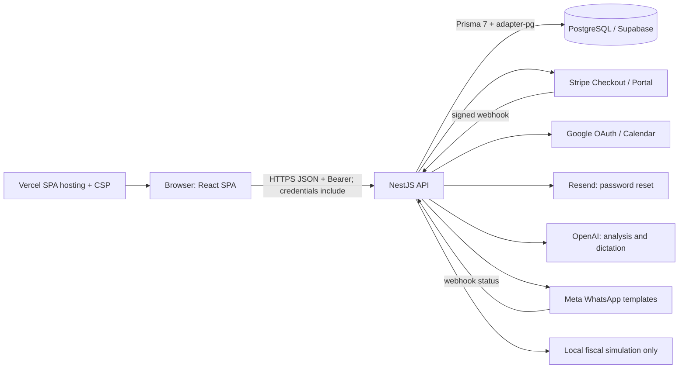
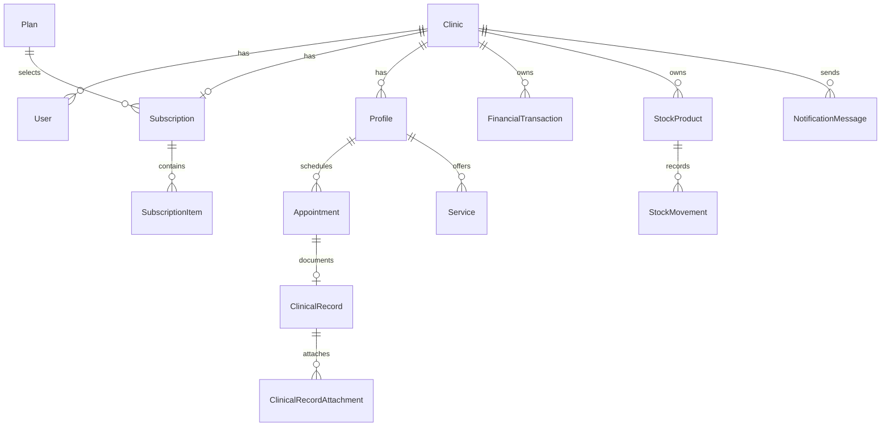

# Current system architecture

Reviewed against both checkouts on 2026-09-20. See [requirements](../requirements/functional.md) for feature completeness and [release gates](../deployment/production-readiness.md) for deployment evidence.

Vercel/Render/Supabase are configuration targets documented in the examples, not proof of the current deployed infrastructure. `vercel.json` exists; no Render infrastructure manifest was found. No production console or database was queried during this audit.

## Frontend

React 19, Vite 8, TypeScript 6, Tailwind 4, Radix/shadcn patterns and TanStack Router; Vitest/RTL, Biome and Knip. Bun is pinned in package.json. Feature-first folders separate route pages, orchestration containers, hooks, typed services and presentational components. Charts use Recharts; marketing also uses Three/Fiber/Drei, GSAP and Motion. Do not expand these dependencies to routine operational screens.

`src/app/router.tsx` owns route authorization/navigation. `src/services/http.ts` adds credentials, Bearer tokens, a default 15-second timeout, translated errors, single-flight refresh after 401 and subscription navigation after 402. Response types are compile-time assertions, not runtime response validation. Downloads/audio-related calls need separate review because not every request passes through `apiRequest`.

Access tokens live in memory. localStorage keeps only a session-presence marker, plus feature-specific non-auth preferences; legacy persistent tokens/user data are removed. This reduces persistent token exposure but does not make the application immune to XSS.

## Backend

NestJS 11 modular monolith, Express 5, Prisma 7/PostgreSQL, class-validator DTOs. Controllers resolve caller scope and delegate to services. AppModule registers guards in this order: throttling → JWT → tenant → role → billing → plan feature. `@Public()` and explicit role policies must be interpreted with these guards. `AccessPolicyService` centralizes role/clinic/profile restrictions; the HTTP policy matrix tests declared routes.

The API uses `/api` by default. `/webhooks/whatsapp` is explicitly outside the prefix. Bootstrap applies exact-origin credentialed CORS, Helmet, no-store, strict validation and body limits (100 KB normally; 6 MB for recognized clinical dictation paths). The dictation path matcher only recognizes `/api/...` and unprefixed paths: changing API_PREFIX is not transparently supported there.

## Identity and tenancy

Clinic is the tenant. ADMIN is platform-scoped; OWNER/DENTIST/ASSISTANT belong to one clinic. PATIENT is an incomplete Google-onboarding identity with no clinic, not a patient portal account. Roles are separate policies, not an inheritance hierarchy. JWT validation reloads user role, active/deleted state and tokenVersion from the database.

Login/register return an access JWT and set an opaque refresh cookie. Refresh rotates a SHA-256-hashed stored token transactionally; reuse revokes active refresh sessions. Logout requires Bearer plus the cookie when present. Refresh/logout check Origin. Production cookies are HttpOnly/Secure/SameSite=None; local cookies use Lax. Browsers blocking third-party cookies remain a real deployment risk; same-site custom domains should be evaluated before commercial launch.

## Database boundaries

The [generated schema reference](../integrations/database-reference.md) preserves all 46 models and their actual constraints. Important relationships:

This diagram is deliberately partial; optional FK details are in the schema. A canonical **`Patient`** model is the clinical identity root: `Appointment`, `ClinicalRecord`, `OdontogramRecord` and `PatientAvatar` each carry a nullable `patientId` FK, and `Patient.id` — never a contact value — is identity. Name, email and phone are attributes with no uniqueness constraint, because two people may legitimately share all three. `patientId` is nullable during the transition: rows predating the migration still resolve through the legacy contact-matching path, which refuses ambiguous lookups, until an operator reconciles them. **`ServiceInvoice.patientId` is unrelated** — it is a pre-existing FK to `User` kept for the fiscal API contract. See [patient identity design](../deployment/patient-identity-design.md).

User/Clinic use deletedAt; many other domains use status/isActive rather than universal soft deletion. Financial values use integer cents where declared; other numeric types are explicitly shown in the schema. Prisma FKs do not universally encode same-clinic relations, so service-level checks remain essential. Appointment creation uses a transaction-scoped PostgreSQL advisory lock. Financial transaction uniqueness prevents repeated appointment/source and fixed-expense/date entries. Stock movements and notification quota reservations use transactions/conditional writes.

SQL migrations add constraints Prisma cannot express: one active OWNER per clinic and the role/clinic shape check. Validate migrations from zero with the repository script, not `db push`. Never edit applied migrations. AuditLog/PrivacyRequest contain scalar identifiers without all corresponding tenant FKs; privacy administration is platform-only. StripeEvent retains raw payloads, which belong in retention/access-control scope.

## Integrations and execution model

Stripe is external billing authority; local trial is seven days without creating a Stripe subscription. Webhook failures return 503 for provider retry. Event completion and local state changes share a PostgreSQL transaction with an advisory lock across replicas; subscription updates/invoices retrieve current Stripe state and map its price. Current subscription/customer matching protects replacements. No new queue; network reads are bounded inside the transaction and lock contention must be monitored. See [business rules](../requirements/business-rules.md).

Google login and Google Calendar use different OAuth configuration. Calendar supports owner clinic connections and dentist personal connections, encrypted tokens and outbound synchronization. This is not evidence of two-way synchronization.

WhatsApp selects local simulation unless real sending is enabled. Consent, templates, quota reservation, manual sending and delivery status receipt exist. No durable worker or scheduled reminder engine was found. Fiscal issue/cancel is explicitly simulated, not legally valid NFS-e. Resend sends password resets. AI analyzes clinic operations and structures audio into draft clinical fields; outputs require human review. No medical diagnostic automation is warranted.

## Reliability boundary

Address lookup is another external integration: `src/services/cep/cep.service.ts` sends the entered eight-digit CEP directly from the browser to ViaCEP. The committed Vercel CSP does not allow `https://viacep.com.br` in `connect-src`, so deployed lookup is blocked under that policy; manual address entry remains available. Permit that specific origin with a regression test before advertising automatic lookup as production-validated. Do not broaden CSP to arbitrary hosts.

Health returns HTTP 503 when the database is unavailable. Middleware assigns a new request UUID, exposes X-Request-ID, and the exception filter includes it in error responses/5xx logs with authenticated clinic context. URL queries are omitted. Generic errors and token redaction do not guarantee removal of all patient data in arbitrary messages/path identifiers. No frontend error collector, release correlation or configured alerting has been verified. Throttling and login counters are in process memory. Start with one API instance and documented recovery; horizontal scaling requires shared rate-limit state and durable integration delivery first.
